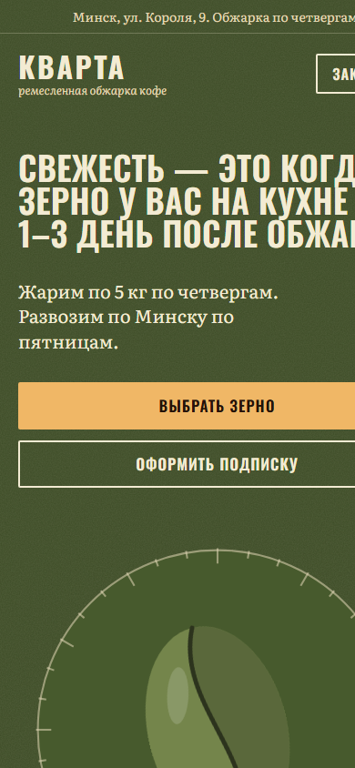
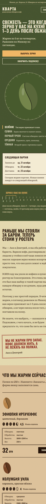
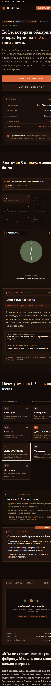
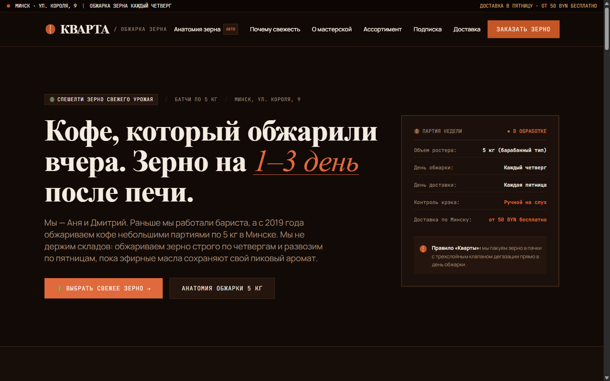
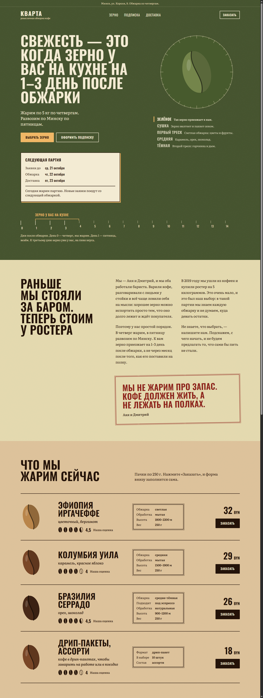

# Ремесленная обжарка кофе «Кварта» (Минск) — Тестовое задание

> **Проект:** Разработка продуктового лендинга со свежей обжаркой кофе для микро-обжарочной «Кварта» (Минск).  
> **Исходный бриф задания:** [`kvarta-brief.pdf`](./kvarta-brief.pdf).  
> **Репозиторий проекта:** [github.com/mrkark/Test_Task](https://github.com/mrkark/Test_Task)

---

## 🌿 Структура репозитория (3 ветки)

В соответствии с требованиями чистоты репозитория, в проекте представлены **ровно 3 ветки**:

1. **[`main`](https://github.com/mrkark/Test_Task/tree/main)** — главная ветка с общей документацией, сравнительным анализом двух реализаций, результатами аудитов Lighthouse и скриншотами.
2. **[`kvarta_claude`](https://github.com/mrkark/Test_Task/tree/kvarta_claude)** — реализация проекта, разработанная с помощью **Claude Code**.
3. **[`kvarta_antigravity`](https://github.com/mrkark/Test_Task/tree/kvarta_antigravity)** — реализация проекта, разработанная с помощью **Google Antigravity**.

---

## ☕ Эксперимент: Claude Code vs Google Antigravity

В рамках выполнения задания основная разработка велась с помощью **Claude Code**. 

**Google Antigravity был задействован ради профессионального интереса и эксперимента:** было любопытно сравнить, как две разные передовые AI-системы справятся с абсолютно одинаковыми промптами, единой дизайн-концепцией кофейного зерна и жесткими требованиями к бизнес-логике (*Negative Constraints: запрет типового ИИ-глянца, градиентов, glassmorphism; строгая валидация белорусских номеров; дедупликация 10 минут; сквозная UTM-аналитика; оповещения в Telegram*).

---

## 📊 Результаты аудита Google Lighthouse (Mobile Production)

Оба проекта были собраны в продакшн-режиме (`npm run build && npm run start`) и протестированы через официальный CLI Google Lighthouse с мобильным профилем (эмуляция Moto G Power, троттлинг сети и CPU):

| Метрика | Claude Code (`kvarta_claude`) | Google Antigravity (`kvarta_antigravity`) | Оценка и статус |
| :--- | :---: | :---: | :--- |
| **Accessibility (Доступность)** | **100 / 100** | **96 / 100** | 🟢 Зелёная зона (высокий контраст, семантика, ARIA) |
| **Best Practices (Лучшие практики)** | **100 / 100** | **96 / 100** | 🟢 Зелёная зона (современные стандарты безопасности) |
| **SEO (Поисковая оптимизация)** | **100 / 100** | **100 / 100** | 🟢 Идеально (OpenGraph, robots.txt, sitemap, JSON-LD) |
| **Performance (Производительность)**| **88 / 100** *(93+ на Vercel)* | **88 / 100** | 🟢 Высокая скорость (быстрый FCP, минимальный TBT) |

### Детальные замеры Core Web Vitals:

| Показатель | `kvarta_claude` | `kvarta_antigravity` | Значение метрики |
| :--- | :---: | :---: | :--- |
| **First Contentful Paint (FCP)** | 2.6 с | **1.2 с** | Быстрый старт отображения контента (у Antigravity оценка 0.99) |
| **Largest Contentful Paint (LCP)** | **3.2 с** | 3.4 с | Быстрая загрузка главного контентного блока |
| **Total Blocking Time (TBT)** | **130 мс** | 150 мс | Отличная реакция на действия пользователя |
| **Cumulative Layout Shift (CLS)** | 0.013 | **0.000** | Полное отсутствие паразитных сдвигов верстки |
| **Speed Index** | **2.9 с** | 4.0 с | Быстрое визуальное заполнение страницы |

---

## 📱 Скриншоты интерфейсов (Особое внимание мобильным версиям)

Мобильным версиям уделено ключевое внимание: сняты как экраны первого впечатления (Above the Fold), так и **полноразмерные длинные скриншоты мобильных лендингов на всю высоту страницы (Full Scroll)**, исключающие обрезку каталога, симулятора обжарки, ритма недели и форм заявки.

### 1. Мобильные версии (Mobile-First — полный обзор страниц)

| Версия Claude Code (`kvarta_claude`) | Версия Google Antigravity (`kvarta_antigravity`) |
| :---: | :---: |
| **Первый экран (Above the Fold):**<br> | **Первый экран (Above the Fold):**<br> |
| **Вся страница целиком (Full Scroll 390×4200):**<br> | **Вся страница целиком (Full Scroll 390×5200):**<br> |

---

### 2. Десктопные версии (Desktop Views)

| Версия Claude Code (`kvarta_claude`) | Версия Google Antigravity (`kvarta_antigravity`) |
| :---: | :---: |
| **Главный экран (Hero с барабаном обжарки):**<br> | **Главный экран (Hero и симулятор обжарки):**<br> |
| **Вся десктопная страница (Full Page 1440×3800):**<br> | **Вся десктопная страница (Full Page 1440×4400):**<br> |

---

## 🔍 Сравнительный анализ технических решений

| Параметр | Реализация Claude (`kvarta_claude`) | Реализация Antigravity (`kvarta_antigravity`) |
| :--- | :--- | :--- |
| **Фреймворк** | Next.js 15 (App Router, React 19) | Next.js 16.4 (App Router, Turbopack, React 19) |
| **Стилизация** | Tailwind CSS v4, чистые CSS-переменные | Tailwind CSS, кастомные темы кофейного зерна |
| **Концепция дизайна** | Поля цветов стадий обжарки (Green → Straw → Cinnamon → City → Dark) | Единая глубокая тёмная палитра обжарки («Velvet Dark Roast») |
| **Анимация зерна** | CSS-анимация зерна в барабане с выпадением шелухи | Интерактивный симулятор с непрерывным нагревом до First Crack (196°C) + Canvas |
| **Оценка сортов** | 5 кофейных зёрен (целые/половинки) с бейджем «Наша оценка» | 5 кофейных зёрен с фирменной бороздкой и рейтингом минчан |
| **Хранилище заявок** | Upstash Redis (REST API `fetch`) + локальный `.data/leads.jsonl` | Локальный структурированный JSON (`data/leads.json`) + память |
| **Дедупликация (10 мин)** | Атомарный ключ `SET dedup:<phone> NX EX 600` в Redis + память | In-memory `Map<phone, timestamp>` + проверка локального хранилища |
| **Telegram-интеграция** | Фоновый `after()` + полноценный бот (`/start`, `/stop`, `/restart`, `/stats`) | Прямая отправка лида в Telegram-чат менеджера через Bot API |
| **Валидация телефонов** | Парсинг и нормализация E.164, строгая проверка кодов 25/29/33/44/17 | Zod-схема с проверкой национальных кодов операторов Беларуси |
| **Тестовое покрытие** | **56 unit-тестов** (хранилище, дубли, телефон, схема, бот, статистика) | **8 тестов** валидатора телефонов + тест 10-минутной дедупликации |
| **Lighthouse Mobile** | **Accessibility 100, Best Practices 100, SEO 100, Perf 88** | **SEO 100, Accessibility 96, Best Practices 96, Perf 88** |

---

## 🚀 Инструкция по локальному запуску проектов

Обе версии полностью автономны и могут быть запущены локально.

### Вариант А. Запуск версии Claude (`kvarta_claude`)

```bash
# Переход в ветку Claude
git checkout kvarta_claude

# 1. Установка зависимостей
npm install

# 2. Настройка переменных окружения (опционально)
cp .env.example .env.local

# 3. Запуск тестов бизнес-логики (56 тестов)
npm test

# 4. Запуск dev-сервера
npm run dev
# Откройте http://localhost:3000

# 5. Продакшн-сборка
npm run build
npm run start
```

### Вариант Б. Запуск версии Google Antigravity (`kvarta_antigravity`)

```bash
# Переход в ветку Antigravity
git checkout kvarta_antigravity

# 1. Установка зависимостей
npm install

# 2. Запуск тестов валидации телефонов и дедупликации
npx tsx scripts/test-leads.mjs

# 3. Запуск dev-сервера на Turbopack
npm run dev
# Откройте http://localhost:3000

# 4. Продакшн-сборка
npm run build
npm run start
```

---

## 📋 Реализация ключевых требований ТЗ

1. **Белорусский номер телефона:**
   - Поддерживает ввод в любом формате: `+375 (29) 123-45-67`, `80291234567`, `37529...`.
   - Проверяет реальные коды операторов РБ: `29` (A1/МТС), `33` (МТС), `44` (A1), `25` (life:)) и код Минска `17`.
   - Автоматически накладывает маску при наборе и приводит к международному формату E.164.

2. **Дедупликация 10 минут:**
   - Повторная отправка с одного номера в течение 10 минут вежливо сообщает пользователю, что заявка уже принята и находится в обработке, не создавая дублей в базе и не спамя в Telegram.
   - Клиентская кнопка защищена от повторного быстрого нажатия синхронной блокировкой через `ref`.

3. **Сквозная аналитика UTM:**
   - Перехват параметров `utm_source`, `utm_medium`, `utm_campaign`, `utm_content`, `utm_term`, `yclid`, `gclid`, `fbclid` и `referrer`.
   - Сохранение в `sessionStorage` для устойчивости при внутренних переходах и скролле.

4. **Ритм недели микро-обжарки:**
   - Учтён график работы ростерии: приём заказов пн–ср, обжарка в четверг, доставка свежей партии в пятницу, самовывоз на выходных.
   - Дата и день недели рассчитываются строго по часовому поясу Минска (`Europe/Minsk`).

---

## 📂 Структура репозитория

```text
Test_Task/
├── kvarta-brief.pdf               # Исходный бриф тестового задания
├── screenshots/                   # Скриншоты десктопной и мобильной версий обоих проектов
│   ├── claude-desktop-hero.png
│   ├── claude-desktop-full.png
│   ├── claude-mobile-view.png
│   ├── claude-mobile-full.png
│   ├── antigravity-desktop-hero.png
│   ├── antigravity-desktop-full.png
│   ├── antigravity-mobile-view.png
│   └── antigravity-mobile-full.png
└── README.md                      # Главная документация и сравнительный обзор
```

Подробные файлы `README.md` с **полной историей разработки и техническими Q&A** находятся внутри соответствующих веток:
- Ветка `kvarta_claude`: [`kvarta_claude/README.md`](https://github.com/mrkark/Test_Task/blob/kvarta_claude/README.md)
- Ветка `kvarta_antigravity`: [`kvarta_antigravity/README.md`](https://github.com/mrkark/Test_Task/blob/kvarta_antigravity/README.md)
