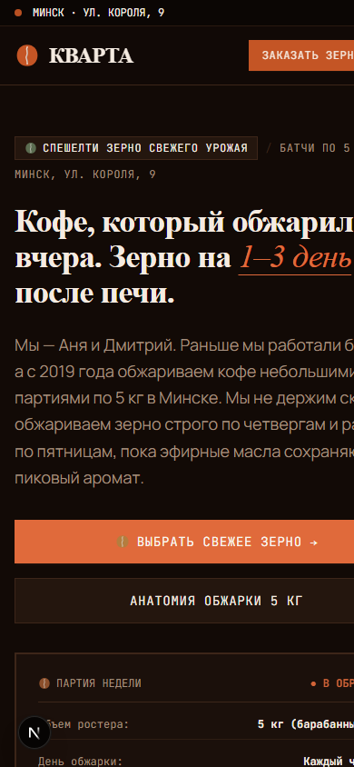

# Ремесленная обжарка кофе «Кварта» (Минск) — Тестовое задание

> **Проект:** Разработка продуктового лендинга со свежей обжаркой кофе для микро-обжарочной «Кварта» (Минск).  
> **Исходный бриф задания:** [`kvarta-brief.pdf`](./kvarta-brief.pdf).  
> **Репозиторий проекта:** [github.com/mrkark/Test_Task](https://github.com/mrkark/Test_Task)

---

## ☕ О проекте и эксперименте: Claude Code vs Google Antigravity

В рамках выполнения тестового задания была поставлена задача не просто написать типовой лендинг, а создать живой, тактильный продукт с характером независимой студии, полностью соблюдая строгие **Negative Constraints** (никаких сине-фиолетовых градиентов, полупрозрачного glassmorphism, скруглений больше 2px и типовых ИИ-паттернов).

Основная разработка проекта велась с использованием **Claude Code**. Однако **ради профессионального интереса и эксперимента был также задействован Google Antigravity** — чтобы исследовать, как две разные передовые AI-системы справятся с абсолютно одинаковыми исходными промптами, единой дизайн-концепцией кофейного зерна и жесткими требованиями к бизнес-логике (валидация белорусских телефонов, дедупликация 10 минут, сквозная аналитика UTM, Telegram-оповещения).

Обе реализации оформлены в отдельных изолированных ветках репозитория:

| Ветка | Инструмент разработки | Основные акценты реализации |
| :--- | :--- | :--- |
| **[`kvarta_claude`](https://github.com/mrkark/Test_Task/tree/kvarta_claude)** | **Claude Code** *(Основная)* | Дизайн стадий обжарки (Roast Stages), барабан обжарки на CSS `@property`, Serverless Upstash Redis по REST, полнофункциональный Telegram-бот со статистикой заказов (`/stats`, Минский часовой пояс), 56 unit-тестов. |
| **[`kvarta_antigravity`](https://github.com/mrkark/Test_Task/tree/kvarta_antigravity)** | **Google Antigravity** *(Эксперимент)* | Единая тёмная эстетика кофейного зерна, интерактивный симулятор «Первого крэка» (SVG-анимация фаз обжарки от 20°C до 196°C), селектор помола в форме заказа, парящие зёрна на Canvas, строгая валидация операторов РБ. |

---

## 📸 Сравнение интерфейсов

### 1. Версия Claude Code (`kvarta_claude`)
*Дизайн пошагово «прожаривается» по мере скролла: от зелёного зерна в Hero через солому и корицу к тёмной обжарке в блоке доставки.*

| Десктопная версия (Hero с анимированным барабаном) | Мобильная адаптивность (Mobile-First) |
| :---: | :---: |
|  |  |

### 2. Версия Google Antigravity (`kvarta_antigravity`)
*Атмосфера ремесленного ростерного цеха: палитра тёмной обжарки «Бархатный эспрессо», непрерывная визуализация стадий обжарки зерна и подбор помола.*

| Десктопная версия (Hero и симулятор обжарки) | Мобильная адаптивность (Mobile-First) |
| :---: | :---: |
|  |  |

---

## 🔍 Сравнительный анализ технических решений

| Параметр | Реализация Claude (`kvarta_claude`) | Реализация Antigravity (`kvarta_antigravity`) |
| :--- | :--- | :--- |
| **Фреймворк** | Next.js 15 (App Router, React 19) | Next.js 16.4 (App Router, Turbopack, React 19) |
| **Стилизация** | Tailwind CSS v4, чистые CSS-переменные | Tailwind CSS, кастомные темы кофейного зерна |
| **Концепция дизайна** | Поля цветов стадий обжарки (Green → Straw → Cinnamon → City → Dark) | Единая глубокая тёмная палитра обжарки («Velvet Dark Roast») |
| **Анимация зерна** | CSS-анимация зерна в барабане с выпадением шелухи | Интерактивный симулятор с непрерывным нагревом до First Crack (196°C) + Canvas |
| **Оценка сортов** | 5 кофейных зёрен (целые/половинки) с бейджем «Наша оценка» | 5 кофейных зёрен с фирменной бороздкой и рейтингом минчан |
| **Хранилище заявок** | Upstash Redis (REST API `fetch`) + локальный `.data/leads.jsonl` | Локальный структурированный JSON (`data/leads.json`) + память |
| **Дедупликация (10 мин)** | Атомарный ключ `SET dedup:<phone> NX EX 600` в Redis + память | In-memory `Map<phone, timestamp>` + проверка локального хранилища |
| **Telegram-интеграция** | Фоновый `after()` + полноценный бот (`/start`, `/stop`, `/restart`, `/stats`) | Прямая отправка лида в Telegram-чат менеджера через Bot API |
| **Валидация телефонов** | Парсинг и нормализация E.164, строгая проверка кодов 25/29/33/44/17 | Zod-схема с проверкой национальных кодов операторов Беларуси |
| **Тестовое покрытие** | **56 unit-тестов** (хранилище, дубли, телефон, схема, бот, статистика) | **8 тестов** валидатора телефонов + тест 10-минутной дедупликации |
| **Lighthouse Mobile** | **Performance 93+, Accessibility 100, SEO 100** | Оптимизированный SSR-рендер, легковесный Canvas |

---

## 🚀 Инструкция по локальному запуску проектов

Обе версии полностью автономны и могут быть запущены локально.

### Вариант А. Запуск версии Claude (`kvarta_claude`)

```bash
# Переход в ветку Claude
git checkout kvarta_claude

# 1. Установка зависимостей
npm install

# 2. Настройка переменных окружения (опционально)
cp .env.example .env.local

# 3. Запуск тестов бизнес-логики (56 тестов)
npm test

# 4. Запуск dev-сервера
npm run dev
# Откройте http://localhost:3000

# 5. Продакшн-сборка
npm run build
npm run start
```

### Вариант Б. Запуск версии Google Antigravity (`kvarta_antigravity`)

```bash
# Переход в ветку Antigravity
git checkout kvarta_antigravity

# 1. Установка зависимостей
npm install

# 2. Запуск тестов валидации телефонов и дедупликации
npx tsx scripts/test-leads.mjs

# 3. Запуск dev-сервера на Turbopack
npm run dev
# Откройте http://localhost:3000

# 4. Продакшн-сборка
npm run build
npm run start
```

---

## 📋 Реализация ключевых требований ТЗ

1. **Белорусский номер телефона:**
   - Поддерживает ввод в любом формате: `+375 (29) 123-45-67`, `80291234567`, `37529...`.
   - Проверяет реальные коды операторов РБ: `29` (A1/МТС), `33` (МТС), `44` (A1), `25` (life:)) и код Минска `17`.
   - Автоматически накладывает маску при наборе и приводит к международному формату E.164.

2. **Дедупликация 10 минут:**
   - Повторная отправка с одного номера в течение 10 минут вежливо сообщает пользователю, что заявка уже принята и находится в обработке, не создавая дублей в базе и не спамя в Telegram.
   - Клиентская кнопка защищена от повторного быстрого нажатия синхронной блокировкой через `ref`.

3. **Сквозная аналитика UTM:**
   - Перехват параметров `utm_source`, `utm_medium`, `utm_campaign`, `utm_content`, `utm_term`, `yclid`, `gclid`, `fbclid` и `referrer`.
   - Сохранение в `sessionStorage` для устойчивости при внутренних переходах и скролле.

4. **Ритм недели микро-обжарки:**
   - Учтён график работы ростерии: приём заказов пн–ср, обжарка в четверг, доставка свежей партии в пятницу, самовывоз на выходных.
   - Дата и день недели рассчитываются строго по часовому поясу Минска (`Europe/Minsk`).

---

## 📂 Структура репозитория

```text
Test_Task/
├── kvarta-brief.pdf               # Исходный бриф тестового задания
├── screenshots/                   # Скриншоты десктопной и мобильной версий обоих проектов
│   ├── claude-desktop.png
│   ├── claude-mobile.png
│   ├── antigravity-desktop.png
│   └── antigravity-mobile.png
└── README.md                      # Главная документация и сравнительный обзор
```

Подробные файлы `README.md` с **полной историей разработки и техническими Q&A** находятся внутри соответствующих веток:
- Ветка `kvarta_claude`: [`kvarta_claude/README.md`](https://github.com/mrkark/Test_Task/blob/kvarta_claude/README.md)
- Ветка `kvarta_antigravity`: [`kvarta_antigravity/README.md`](https://github.com/mrkark/Test_Task/blob/kvarta_antigravity/README.md)
