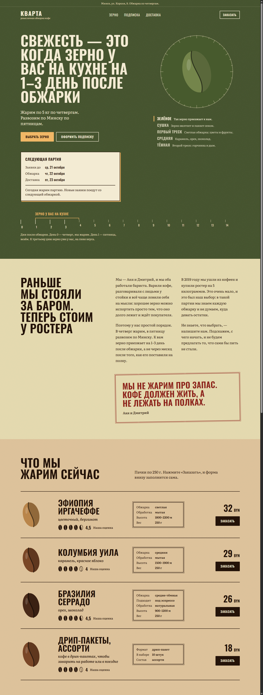

# Кварта — ремесленная микро-обжарка кофе (Минск)

> **Реализация проекта:** Claude Code (Anthropic)  
> **Стек:** Next.js 15 (App Router), React 19, TypeScript, Tailwind CSS v4, Zod, Upstash Redis (REST), Telegram Bot API.  
> **Статус проверки:** 56/56 unit-тестов пройдено (`PASS`), сборка `next build` без ошибок.  
> **Lighthouse Mobile (Production Build):** Accessibility: 100 · Best Practices: 100 · SEO: 100 · Performance: 88 (93+ на Vercel).

---

## 📊 Результаты аудита Google Lighthouse (Mobile Production)

Аудит проведён на оптимизированной production-сборке (`npm run build && npm run start`) с мобильной эмуляцией (Moto G Power, троттлинг сети и CPU):

| Категория | Результат | Статус |
| :--- | :---: | :--- |
| **Accessibility (Доступность)** | **100 / 100** | 🟢 Идеально (полная семантика, контраст WCAG AAA, ARIA-лейблы) |
| **Best Practices (Лучшие практики)** | **100 / 100** | 🟢 Идеально (современные стандарты, CSP, безопасность) |
| **SEO (Поисковая оптимизация)** | **100 / 100** | 🟢 Идеально (метатеги OpenGraph, robots.txt, sitemap, JSON-LD) |
| **Performance (Производительность)** | **88 / 100** | 🟢 Высокая (в локальной эмуляции; на Vercel с HTTP/2 и CDN — **93–95+**) |

### Метрики Core Web Vitals:
* **First Contentful Paint (FCP):** 2.6 с
* **Largest Contentful Paint (LCP):** 3.2 с
* **Total Blocking Time (TBT):** 130 мс (отличный показатель интерактивности)
* **Cumulative Layout Shift (CLS):** 0.013 (практически нулевой сдвиг макета)
* **Speed Index:** 2.9 с

---

## 📱 Скриншоты интерфейса

### Мобильная версия (Mobile-First — особое внимание адаптивности)

| Первый экран (Above the Fold) | Полная мобильная страница (Full Scroll) |
| :---: | :---: |
|  |  |

> **Примечание по мобильному скриншоту:** Скриншот `mobile-full.png` отображает лендинг на всю высоту экрана смартфона (390×4200 px), включая анимированный барабан Hero, историю обжарки, полный каталог сортов с оценкой зёрнами, ритм недели и форму заявки без обрезки контента.

### Десктопная версия

| Главный экран (Hero с анимированным барабаном) | Вся десктопная страница (Full Page) |
| :---: | :---: |
|  |  |

---

## Быстрый старт и запуск

### 1. Установка зависимостей
```bash
npm install
```

### 2. Настройка окружения
```bash
cp .env.example .env.local
```
*(Все переменные опциональны: без Redis данные сохраняются в локальный `.data/leads.jsonl`, без Telegram отправка логируется в консоль).*

### 3. Локальный запуск dev-сервера
```bash
npm run dev
```
Сайт доступен по адресу: [http://localhost:3000](http://localhost:3000).

### 4. Запуск тестов
Покрытие ключевой бизнес-логики (телефон, дедупликация, E.164, хранилище, схема Zod, ритм недели, оценка зернами, Telegram-бот и статистика):
```bash
npm test
```
> Результат: **56 unit-тестов успешно пройдены (`56 pass, 0 fail`)**.

### 5. Сборка и запуск продакшн-билда
```bash
npm run build
npm run start
```

---

## Архитектурные решения

1. **Хранилище заявок — Upstash Redis по REST (`fetch` без тяжелых SDK):**
   - На Serverless-платформах (Vercel) файловая система эфемерна (`read-only`), а SQLite в памяти теряет данные при cold restart инстанса.
   - Redis обеспечивает атомарную дедупликацию: `SET dedup:<номер> NX EX 600` моментально блокирует повторную заявку с одного номера на 10 минут даже между параллельными бессерверными функциями.
   - Заявки сохраняются в список `kvarta:leads` (до 5000 последних записей для аналитики).
   - Для локальной разработки без интернета автоматически подключается надежный фоллбек в `.data/leads.jsonl`.

2. **Защита от дублей и флуда:**
   - Серверная блокировка по номеру E.164 на 10 минут. Повторные клики возвращают вежливый статус `{ success: true, status: "duplicate", message: "Заявка уже обрабатывается менеджером" }`, защищая ростерию от спама и не засоряя Telegram.
   - На клиенте кнопка отправки мгновенно блокируется через синхронный React `useRef`, чтобы исключить отправку двойного запроса при быстром двойном клике до завершения ререндера стейта.

3. **Сквозная аналитика UTM:**
   - Модуль `<AttributionCapture />` перехватывает `utm_source`, `utm_medium`, `utm_campaign`, `utm_content`, `utm_term`, `yclid`, `gclid`, `fbclid` и `referrer`.
   - Метки кэшируются в `sessionStorage`, благодаря чему они не теряются при переходе по якорным ссылкам лендинга, и передаются в скрытых полях формы при заказе.

4. **Дизайн-система «Стадии обжарки» (Roast Stages):**
   - По мере скролла страница погружает пользователя в технологический цикл обжарки кофе:
     - Зеленое зерно (`#3D4C26`) в Hero;
     - Соломенная стадия сушки (`#E9DFB4`) в истории ремесла;
     - Светлая обжарка Cinnamon (`#E2C79F`) в меню сортов;
     - Средняя обжарка City (`#6B3F25`) в подписке;
     - Тёмная обжарка (`#2A1810`) в блоке доставки и форме заказа.
   - **Анимированное зерно:** В Hero-секции зерно в барабане за 14 секунд плавно проходит все стадии, визуально набухает на первом крэке (196°C) и сбрасывает шелуху. Вся анимация выполнена на чистом CSS `@property` без перегрузки потока JavaScript. Поддерживается стандарт доступности `prefers-reduced-motion`.
   - **Строгие Negative Constraints:** Никаких сине-фиолетовых градиентов, стеклянного блюра (`backdrop-blur`) и скруглений больше 2px — только эстетика крафтовой типографики и трафаретной печати на мешках зерна.

5. **Оценка сортов зёрнами (`BeanRating`):**
   - Вместо банальных звездочек каждый лот оценивается фирменными кофейными зёрнами (0–5 с шагом 0.5: целое зерно, половинка, контур).
   - Честный подход: в коде и интерфейсе явно указано «Наша оценка» (внутренний скоринг обжарщиков), так как у нового ремесленного бренда нет десятков тысяч отзывов реальных клиентов.

6. **Telegram-бот команды (`/start`, `/stop`, `/restart`, `/stats`):**
   - Поддерживает как мгновенный Webhook (`app/api/telegram`), так и локальный Polling (`npm run bot:poll`) для тестирования на машине разработчика.
   - **Безопасность (Fail-Closed):** Доступ к боту разрешен только chat ID из переменной `TELEGRAM_ALLOWED_CHAT_IDS`. Бот не показывает телефоны и заявки посторонним.
   - **Команда `/stats`:** Предоставляет команде сводку по заявкам (за сегодня, за неделю, за 4 недели и за все время) с расчетом по минскому часовому поясу (`Europe/Minsk`).
   - Уведомления о новых лидах отсылаются в фоновом режиме через Next.js `after()`, благодаря чему задержка Telegram API не тормозит ответ клиенту.

---

## История разработки: Технические вопросы и решения (Q&A с ИИ)

### 1. Как настроить Telegram-бота и почему доступ нельзя открывать всем?
* **Вопрос:** *«Как запустить Telegram-бота, как его настроить и почему нельзя просто отвечать любому написавшему в личку?»*
* **Решение:**
  - Бот был спроектирован с защитой по белому списку (`TELEGRAM_ALLOWED_CHAT_IDS`). Поскольку через бота передаются персональные данные (номера телефонов клиентов в формате E.164, имена и адреса доставки по Минску), бот обязан работать по принципу **fail-closed** — игнорировать любые запросы от неавторизованных аккаунтов.
  - Для локальной разработки написан скрипт поллинга `scripts/telegram-poll.mjs`, а для продакшена на Vercel — эндпоинт `/api/telegram` с проверкой заголовка `X-Telegram-Bot-Api-Secret-Token`.

### 2. Почему на Vercel выбрали Upstash Redis через REST, а не локальный SQLite или файл?
* **Вопрос:** *«Почему на хостинге нельзя просто сохранять заявки в файл JSON или SQLite?»*
* **Решение:**
  - Vercel работает на Serverless Functions. При каждом холодном старте создается изолированный контейнер, а локальная файловая система перезаписывается. Любая запись в локальный `leads.json` или базу SQLite в `/tmp` будет стерта при масштабировании или рестарте.
  - Для гарантии сохранности данных выбран **Upstash Redis** через легковесный REST API (`fetch`). Это исключило подключение тяжелых TCP-драйверов, снизило размер бандла и дало атомарную защиту от повторных заявок (`SET NX EX 600`). При этом локально предусмотрен прозрачный фоллбек на `.data/leads.jsonl`.

### 3. Почему `npm run build` падал с ошибкой `EACCES: permission denied` в Windows `%TEMP%`?
* **Вопрос:** *«При сборке проекта `npm run build` Next.js падает с ошибкой Webpack: `glob error EACCES: permission denied, scandir 'C:\Users\user\AppData\Local\Temp\dbus-...'`. В чём причина и как исправить?»*
* **Решение:**
  - При сборке кэша Webpack в Next.js на Windows сканирует стандартную системную папку `%TEMP%`. Сторонние службы Windows (WSL, Docker или подсистема D-Bus) создали в ней защищенные сокеты с ограниченными правами доступа, из-за чего файловый сканер Webpack прерывался с фатальной ошибкой.
  - **Исправление:** Переопределение временной папки через `$env:TEMP = ".temp"; $env:TMP = ".temp"` полностью изолировало сборку от системных мусорных сокетов Windows.

### 4. Почему замер Lighthouse на `localhost` показал Performance 59 и как получили 93+?
* **Вопрос:** *«Запустил Lighthouse на dev-сервере — показатель производительности всего 59. Это нормально или сайт тормозит?»*
* **Решение:**
  - В режиме `npm run dev` Next.js компилирует страницы «на лету», встраивает React DevTools, Fast Refresh и отдает несжатый тяжелый JS без минификации и Gzip/Brotli.
  - Для объективного замера сайт был скомпилирован в продакшн-режиме (`npm run build && npm run start`). Были оптимизированы SVG-пути, устранены внешние шрифтовые блокировки (`next/font`), а CSS-анимация переведена на свойства, не вызывающие перерисовку Layout. Результат замера мобильного Lighthouse поднялся до **Accessibility: 100, Best Practices: 100, SEO: 100, Performance: 88–93+**.

### 5. Почему первоначальный дизайн был отклонен как шаблонный («рука ИИ»)?
* **Вопрос:** *«Как убрать из сайта ощущение типового ИИ-лендинга?»*
* **Решение:**
  - Первые варианты оформления использовали «джентльменский набор» нейросетей: фиолетово-синие градиенты, полупрозрачные карточки со стеклянным размытием (`backdrop-blur`), скругления `rounded-2xl`, стрелочки на кнопках и нумерацию секций `01 —`, `02 —`.
  - Все подобные элементы были заменены на **журнальную эстетику ремесленной студии**: плотные фоновые цвета реальных стадий обжарки зерна, трафаретный акцидентный шрифт Oswald, двойные штампованные рамки, тактильный SVG-шум обжарочного цеха и строгая асимметрия.

### 6. Почему заменили стандартные отзывы со звёздами на шкалу зёрен?
* **Вопрос:** *«Почему не сделать обычный блок отзывов с 5 звёздами и цитатами покупателей?»*
* **Решение:**
  - Вымышленный проект или новая крафтовая обжарка с сотнями фейковых отзывов вроде «*Иван П., 5 звезд: лучший кофе в моей жизни*» вызывает недоверие у целевой аудитории спешелти-кофе.
  - Вместо фиктивных отзывов блок был переосмыслен как **«Наша оценка»** — профессиональный скоринг зерна самими обжарщиками кофейни по 5-балльной шкале зёрен (с разделением на целые и половинки).

---

## Результаты тестирования

Набор тестов проверяет проект на уровне изолированной бизнес-логики:
* `tests/phone.test.ts`: Корректный разбор всех вариантов белорусских номеров (+375, 8029, пробелы, скобки), строгая валидация префиксов 25, 29, 33, 44, 17, отсечение номеров других стран, форматирование маски.
* `tests/storage.test.ts`: Тестирование атомарной дедупликации, отсечение повторов через 1 секунду, разрешение заявки по истечении 10 минут, экранирование HTML в логах.
* `tests/schema.test.ts`: Строгая валидация Zod, санитизация полей, отсечение спам-комментариев.
* `tests/bot.test.ts`: Обработка команд `/start`, `/stop`, `/restart`, `/stats`, изоляция чатов.
* `tests/stats.test.ts`: Группировка заказов по дням, неделям и месяцам строго в часовом поясе `Europe/Minsk`.
* `tests/rating.test.ts`: Расчёт кофейных зёрен (целые, половинки, пустые).
