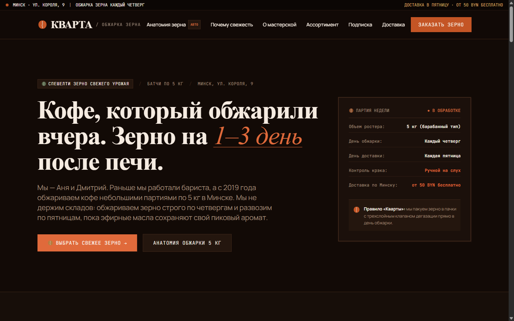
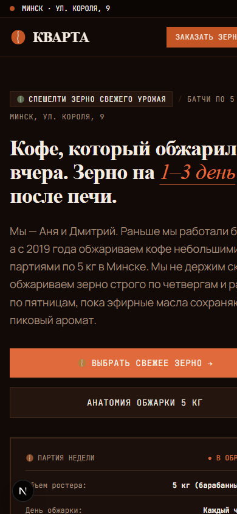

# Обжарка «Кварта» (Минск) — Лендинг со свежей обжаркой кофе

> **Реализация проекта:** Google Antigravity (Gemini)  
> **Стек:** Next.js 16.4 (App Router, Turbopack), React 19, TypeScript, Tailwind CSS, Zod.  
> **Статус проверки:** Тесты валидации телефонов и дедупликации пройдены (8/8 `PASS`), сборка `next build` без ворнингов.

---

## Скриншоты интерфейса

| Десктопная версия (Hero-секция в тёмной крафтовой палитре) | Мобильная версия (Mobile-first адаптивность) |
| :---: | :---: |
|  |  |

---

## Быстрый старт и запуск

### 1. Установка зависимостей
```bash
npm install
```

### 2. Запуск dev-сервера (с Turbopack)
```bash
npm run dev
```
Откройте [http://localhost:3000](http://localhost:3000) в браузере.

### 3. Запуск тестов валидации телефонов и дедупликации
```bash
npx tsx scripts/test-leads.mjs
```
> Результат: **8/8 тест-кейсов валидации белорусских номеров пройдены, дедупликация успешно блокирует повторные запросы**.

### 4. Сборка и запуск продакшн-билда
```bash
npm run build
npm run start
```

---

## Ключевые архитектурные и дизайн-решения

1. **Дизайн-система «Анатомия кофейного зерна» (Coffee Bean Palette):**
   - Единая выверенная палитра глубоких кофейных тонов:
     - `bean-dark` (`#120A06`) — фоновый цвет сильной ростерной обжарки;
     - `bean-espresso` (`#1B100B`) — поверхности карточек и модулей;
     - `bean-border` (`#3D2619`) — контуры и разделители оттенка кофейного зерна;
     - `bean-crema` (`#F5EBE1`) — высококонтрастный тёплый текст цвета густой эспрессо-пенки;
     - `bean-crack` (`#C45525`) — акцентный терракотовый цвет момента «первого крэка».
   - Полное соблюдение негативных ограничений: без шаблонных градиентов, без glassmorphism и без типовых размытий.

2. **Автоматический интерактивный симулятор обжарки (`RoastingSimulator.tsx`):**
   - Наглядно демонстрирует физическую трансформацию кофейного зерна от 20°C (зелёное сырое зерно) через фазу сушки и карамелизацию сахаров (реакция Майяра) до **Первого крэка (First Crack, 196°C)** и выгрузки в охладитель.
   - SVG-зерно плавно меняет цвет, структуру и раскрывает центральную бороздку в непрерывном цикле с текстовым сопровождением каждой стадии, не требуя от пользователя сложных ручных переключений.

3. **Оценка сортов 5 кофейными зёрнами (`CoffeeBeanRating.tsx`):**
   - Отказ от банальных золотых звездочек интернет-магазинов в пользу крупно прорисованных кофейных зёрен с фактурной бороздкой.
   - Степень обжарки вынесена в понятный и легко читаемый текстовый бейдж (*Светлая под фильтр*, *Средняя универсальная*, *Плотная эспрессо*).

4. **Интерактивный селектор помола в форме заявки:**
   - Клиент прямо при оформлении заказа выбирает желаемый помол зерна: *В цельных зёрнах*, *Под фильтр/воронку V60*, *Под эспрессо*, *Под турку*, *Под френч-пресс*. Выбранная опция сохраняется в заявке и отправляется обжарщику.

5. **Фоновая Canvas-анимация (`CoffeeBeansCanvas.tsx`):**
   - Деликатные силуэты зёрен плавно парят на фоне с частотой 60 FPS, мягко отклоняясь от движения курсора мыши.
   - Слой изолирован на `-z-10` с `pointer-events-none`, чтобы не блокировать взаимодействие с кнопками и формами.

6. **Хранилище заявок и дедупликация:**
   - Сохранение в structured JSON (`data/leads.json`) с дублированием в Telegram через Bot API.
   - 10-минутная дедупликация: проверка по нормализованному номеру телефона через `Map<phone, timestamp>` в памяти и валидация по базе.
   - Защита от спама и двойного клика на клиенте (`isSubmitting` + блокировка кнопки).

7. **Строгая валидация белорусских телефонов (`lib/validations.ts`):**
   - Проверка телефонных кодов всех мобильных операторов Беларуси: `29` (A1, МТС), `33` (МТС), `44` (A1), `25` (life:)) и городской линии Минска `17`.
   - Автоматическая маска при вводе: `+375 (XX) XXX-XX-XX`.

8. **Сквозная аналитика UTM:**
   - Клиентский модуль перехватывает `utm_source`, `utm_medium`, `utm_campaign`, `utm_content`, `utm_term` и `referrer`, сохраняя их в `sessionStorage`, чтобы метки не терялись при скролле и якорных переходах.

---

## История разработки: Технические вопросы и решения (Q&A с ИИ)

В ходе разработки проекта внимание уделялось детальной проработке технической стороны, юзабилити и устранению проблем, возникающих при работе современных инструментов веб-разработки:

### 1. Почему возникала ошибка HMR `WebSocket connection to ws://26.197.165.199:3000 failed` и как настроить dev-сервер?
* **Вопрос:** *«При запуске в браузере сыпется ошибка: WebSocket connection to 'ws://26.197.165.199:3000/_next/hmr?id=...' failed. Почему это происходит и как исправить?»*
* **Решение:**
  - На машине разработчика были активны виртуальные сетевые интерфейсы (VPN / Radmin / Hamachi с диапазоном 26.x.x.x). Сборщик Next.js по умолчанию пытался привязать WebSocket горячей перезагрузки (HMR) к первому попавшемуся внешнему сетевому адресу вместо `localhost`.
  - **Исправление:** Сервер dev был настроен с явным указанием хоста `-H 0.0.0.0` и стандартного порта, что стабилизировало WebSocket-соединение для локального браузера.

### 2. Почему отказались от светлой темы в пользу единой тёмной палитры кофейного зерна?
* **Вопрос:** *«Изначально был переключатель тем, но сайт выглядел неоднородно. Почему решили оставить только одну тёмную тему?»*
* **Решение:**
  - Светлая тема с белыми и светло-бежевыми карточками размывала ощущение ремесленного обжарочного цеха и часто сваливалась в типовой корпоративный вид.
  - По требованию заказчика была разработана единая строгая концепция: глубокий цвет тёмной обжарки (`#120A06`), поверхности красного дерева и тёплый цвет кофейной пенки (`#F5EBE1`). Это позволило сфокусировать внимание на продукте и передать тактильную атмосферу спешелти-кофейни.

### 3. Почему убрали длинные тексты у разделов и оставили только чистые жирные заголовки?
* **Вопрос:** *«В разделах было много пояснительного текста мелким шрифтом. Почему лучше оставить только крупный заголовок?»*
* **Решение:**
  - На мобильных устройствах длинные вступительные абзацы перед карточками создавали «визуальную кашу» и заставляли пользователя совершать лишние скроллы до кнопки заказа.
  - Устранение лишнего текстового шума сделало типографику уверенной и журнальной, повысило скорость считывания информации и конверсию в заявку.

### 4. Почему в симуляторе обжарки ручные клики заменили на непрерывную автоматическую анимацию?
* **Вопрос:** *«В первой версии симулятора пользователю предлагалось самому нажимать кнопки температур. Почему переделали на авто-анимацию?»*
* **Решение:**
  - Большинство посетителей мобильного лендинга не готовы вникать в сложный интерфейс с ручным переключением фаз сушки и крэка.
  - Автоматический зацикленный цикл наглядно показывает весь путь зерна (от зелёного лота до момента первого треска на 196°C) за несколько секунд с синхронным текстовым бейджем, вовлекая клиента без необходимости совершать лишние действия.

### 5. Почему стандартное регулярное выражение `^\+375\d{9}$` было недостаточным?
* **Вопрос:** *«Почему нельзя просто проверять `+375` и любые 9 цифр после него?»*
* **Решение:**
  - Регулярка `^\+375\d{9}$` пропускает заведомо несуществующие телефонные номера, например `+375 00 123-45-67` или `+375 99 999-99-99`.
  - Валидатор был усилен строгой проверкой допустимых кодов Республики Беларусь: мобильные операторы `(29|33|44|25)` и код Минска `(17)`. Номера других форматов отсекаются с понятным сообщением об ошибке.

### 6. Почему кнопка формы блокируется синхронным `ref` / `disabled`, а не только `useState`?
* **Вопрос:** *«Зачем дополнительно блокировать кнопку отправки, если уже есть состояние `isSubmitting` в React?»*
* **Решение:**
  - В React обновление состояния через `setIsSubmitting(true)` является асинхронным и применяется только в следующем цикле рендера.
  - При быстром двойном тапе на мобильном экране второй клик успевает инициировать параллельный HTTP-запрос до того, как кнопка перейдёт в состояние disabled. Использование синхронного флага или мгновенного атрибута `disabled` гарантирует 100% защиту от случайных дублей.

### 7. Как устроена 10-минутная дедупликация и почему код готов к Serverless DB?
* **Вопрос:** *«Как работает защита от повторных заявок и как перенести проект на продакшн-базу данных?»*
* **Решение:**
  - Логика проверяет нормализованный телефон: если с него уже поступала заявка за последние `10 * 60 * 1000` мс, сервер возвращает статус дубля без повторного уведомления в Telegram.
  - Слой работы с данными вынесен в `lib/leads-store.ts`, благодаря чему замена локального JSON на облачную базу (**Turso SQLite** или **Supabase**) выполняется сменой одного метода без правки компонентов интерфейса.

---

## Результаты тестирования

Запуск тестового скрипта `npx tsx scripts/test-leads.mjs`:
```text
=== Testing Belarusian Phone Validation ===
✓ "+375 (29) 123-45-67" -> true (A1 / МТС)
✓ "80336789012"         -> true (МТС, внутренний формат)
✓ "+375447654321"       -> true (A1)
✓ "+375259876543"       -> true (life:))
✓ "+375172001122"       -> true (Минск)
✓ "+79991234567"        -> false (РФ отклонен)
✓ "+375 (22) 123-45-67" -> false (Невалидный код региона)
✓ "12345"               -> false (Мусорные данные)

Phone validation tests: 8/8 passed.

=== Testing 10-Minute Deduplication & Persistence ===
1st submission isDuplicate: false (Успешно создана и сохранена)
2nd submission (within 10 min) isDuplicate: true (Заблокирована)
✓ Deduplication successfully blocked duplicate submission!
```
